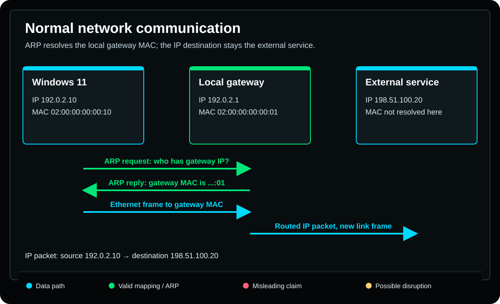
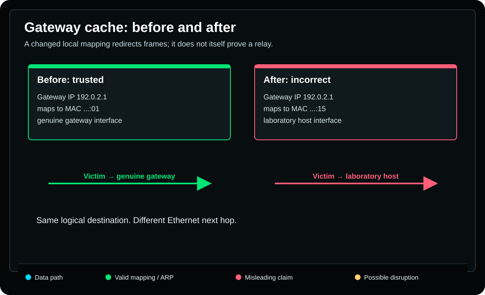
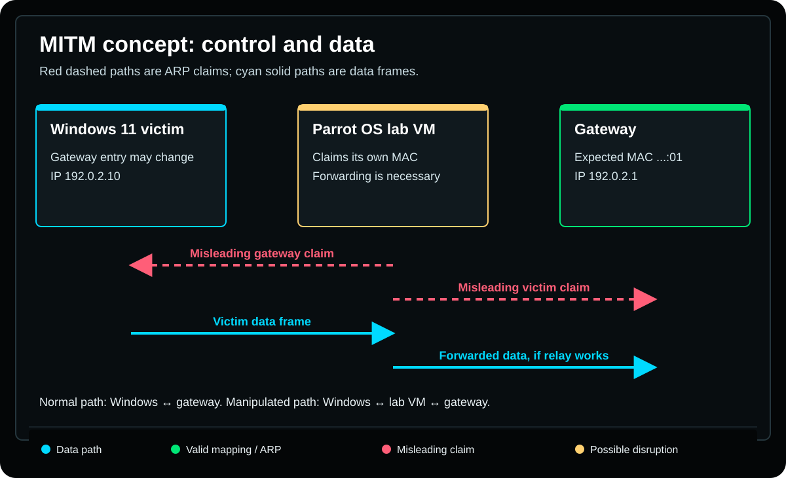
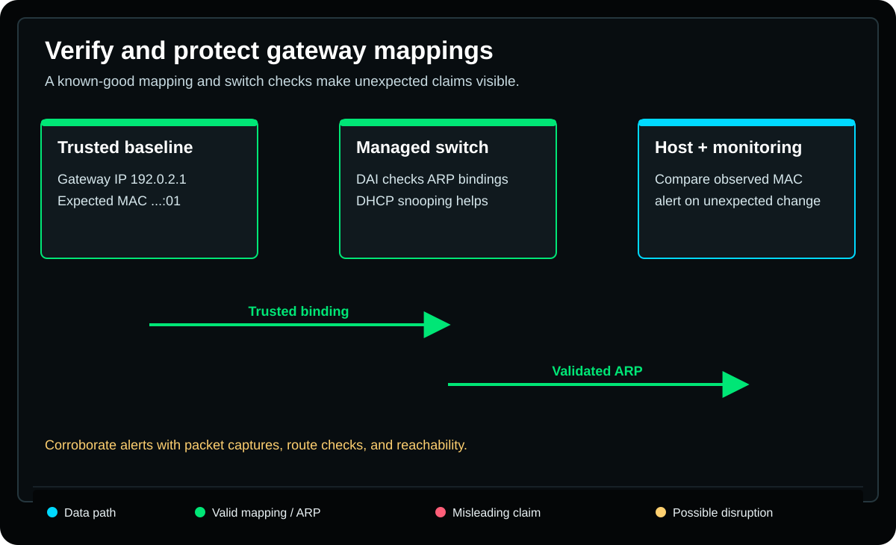

# ARP-MITM-Lab


### ARP Spoofing & Man-in-the-Middle Security Research Laboratory

**An implemented Parrot OS and Windows 11 laboratory with author-confirmed successful ARP cache poisoning.**

     

> Designed for controlled cybersecurity education and authorized network security testing. Use only on systems and networks you own or have explicit permission to assess. [Full notice](DISCLAIMER.md).

## Project overview

ARP-MITM-Lab is a hands-on network security project built with Python, PowerShell, Parrot OS, Windows 11, and VirtualBox. **The author successfully executed the ARP poisoning experiment in a controlled lab.** The project uses that result to explain gateway impersonation, local network trust, victim-side investigation, and defensive monitoring.

| Status | Core result | Lab systems | Languages | Focus |
| --- | --- | --- | --- | --- |
| Implemented | ARP poisoning succeeded (author report) | Parrot OS attacker, Windows 11 victim, VirtualBox | Python, PowerShell | ARP, Layer 2 trust, observation, defense |

The public checkout contains the original, read-only [Windows PowerShell observer](scripts/win11_probe.ps1), guides, and diagrams. The reviewed Python ARP manipulation script remains local to the author and is not downloadable here.

## Project highlights

- **Built and tested:** the author reports successful ARP cache poisoning in the isolated lab.
- **Two viewpoints:** the Parrot OS implementation and a read-only Windows 11 observation script were reviewed for this documentation.
- **Network reasoning:** interface MAC, default route, and neighbor cache explain why the gateway association matters.
- **Defense:** trusted gateway baselines, captures, switch inspection, and recovery checks turn the demonstration into a detection lesson.

## Laboratory architecture



In ordinary off-subnet communication, Windows keeps the external service's IP as the packet destination but sends its **local Ethernet frame** to the gateway's MAC. ARP supplies that next-hop MAC. The gateway routes the IP packet onward in a new link-layer frame. [Topology details](docs/06-network-topology.md).

### Laboratory Demonstration — Successful ARP Cache Poisoning

The author reports that ARP poisoning **worked** in the controlled Parrot OS / Windows 11 environment. The central effect is a manipulated gateway-IP-to-MAC association at the victim: the local frame can be addressed to the laboratory host rather than the genuine gateway interface. This is the practical result around which the project was built.

The investigation followed the network path: identify the active interface, read its current MAC, find the default gateway, inspect local neighbor mappings, and observe the Windows victim's gateway entry. The illustrations below use documentation addresses; they are **not copied terminal output**.


### Before and after: one IP, two possible MACs



The genuine gateway MAC belongs to the router interface. A poisoned entry points the **same gateway IP** to a different local MAC.

### Why this matters for MITM



The reviewed `mitm` mode implements two-sided ARP claims and enables IPv4 forwarding. A transparent MITM also depends on working forwarding and path conditions. The author-confirmed ARP poisoning result does not by itself establish decrypted application content or a measured interception volume.

## Existing lab modes

| Mode | Existing implementation | Lab lesson |
| --- | --- | --- |
| `mitm` | Bidirectional claims, IPv4 forwarding, packet counters | How a changed next hop can put a host in the traffic path |
| `takeover` | Gateway claim to the victim without enabling forwarding | Why an incorrect next hop can interrupt delivery |
| `flood` | Repeated forged ARP claims across addresses derived from the gateway prefix | How repeated control traffic affects neighbor-state investigation |

The three modes exist in the reviewed local Python script. The author confirms the core poisoning experiment, without asserting measured outcomes for every mode. [Implementation details](docs/03-laboratory-modes.md).

## Investigate the network state

| Linux / Parrot OS | Windows 11 | Question answered |
| --- | --- | --- |
| `ip -br addr`, `ip link show` | `ipconfig /all` | Which addresses and interfaces are configured here? |
| `ip route` | `route print` | Which route and gateway would this host use? |
| `ip neigh` | `arp -a` | Which local IPv4-to-MAC mappings are cached? |
| `cat /sys/class/net/<interface>/address` | `Get-NetAdapter` | What MAC is currently exposed for this local interface? |

`cat /sys/class/net/<interface>/address` reads the local interface's current MAC from Linux's kernel-exposed `/sys` tree; `ip -br addr` shows its configured IP. `ip route` identifies the next-hop gateway, and `ip neigh` or Windows `arp -a` shows cached IP-to-MAC mappings. [Network foundations](docs/01-network-foundations.md) explains each.

### Why ARP and Nmap show different devices

`ip neigh` and `arp -a` are **local caches**. Nmap host discovery actively probes a selected scope; ping asks for an ICMP response. Different adapters, VirtualBox modes, subnet boundaries, firewalls, and stale entries can change the results. Ordinary per-VM VirtualBox NAT does not automatically place guests on one shared ARP segment. [Host-discovery guide](docs/02-host-discovery.md).

## Windows victim-side observations

The published [`win11_probe.ps1`](scripts/win11_probe.ps1) reads `arp -a` and structured neighbor entries, watches the gateway MAC, and measures ICMP replies, TCP connection timing, and adapter-counter changes. It does not change Windows network configuration. [How to interpret its measurements](docs/04-victim-observations.md).

## Defensive detection and recovery



Compare the observed gateway MAC with a trusted baseline, inspect suspicious ARP claims, and verify that legitimate mappings return after a lab run. Supported managed switches can use Dynamic ARP Inspection with trusted bindings. TLS protects application data but does not prevent an ARP cache change. [Defense guide](docs/05-defense-and-mitigation.md).

## Read the masterclass

1. [Network foundations](docs/01-network-foundations.md)
2. [Host discovery and VirtualBox](docs/02-host-discovery.md)
3. [Implementation and tested result](docs/03-laboratory-modes.md)
4. [Windows victim observations](docs/04-victim-observations.md)
5. [Defense and mitigation](docs/05-defense-and-mitigation.md)
6. [Network topology and evidence boundaries](docs/06-network-topology.md)
7. [Glossary](docs/glossary.md)
8. [Experiment record and evidence status](results/README.md)

## Repository map

```text
README.md                     Start here
docs/                         Concept lessons and evidence guidance
assets/                       Local SVG illustrations
scripts/win11_probe.ps1       Original read-only Windows observer
results/README.md             Author-reported result and blank measurement template
DISCLAIMER.md                 Scope and isolation
SECURITY.md                   Reporting and publication hygiene
```

## Evidence and attribution

**Confirmed by the author:** ARP poisoning succeeded in the controlled lab. **Confirmed by source review:** the three Python modes and the published Windows measurement behavior. Raw captures, terminal transcripts, and mode-specific outcome measurements are not published. No license was added because redistribution rights for the local Python code were not established. References: [VirtualBox networking](https://docs.oracle.com/en/virtualization/virtualbox/7.2/user/networkingdetails.html), [Nmap host discovery](https://nmap.org/book/man-host-discovery.html), and [Dynamic ARP Inspection](https://www.cisco.com/c/en/us/td/docs/switches/lan/catalyst3560/software/release/15-0_2_se/configuration/guide/scg3560/swdynarp.html).
