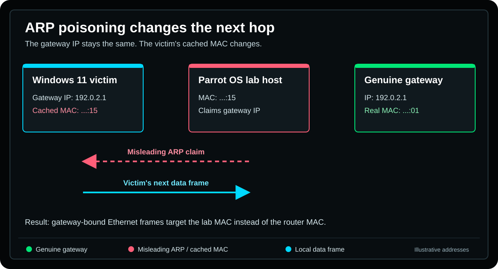
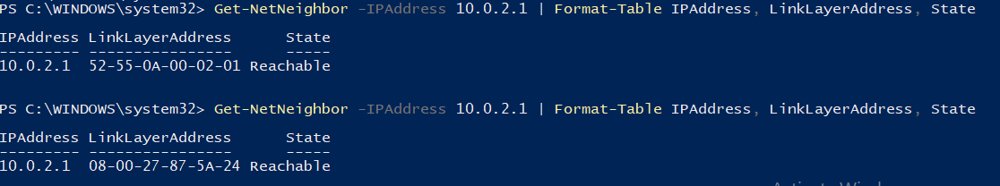
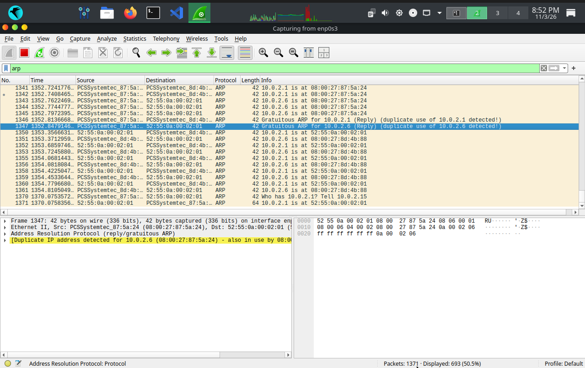
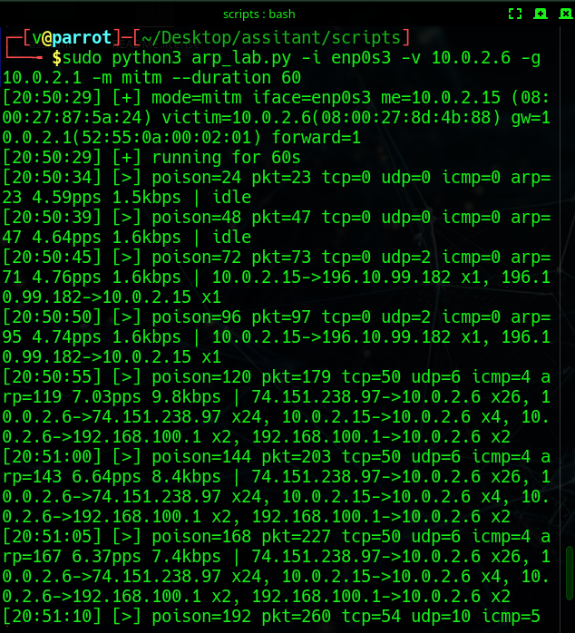

# ARP-MITM-Lab


### ARP Spoofing & Man-in-the-Middle Security Research Laboratory

I developed ARP-MITM-Lab with Python, PowerShell, Parrot OS, Windows 11, and VirtualBox to study how trust in local IPv4 networks can be manipulated and defended. **I successfully tested ARP cache poisoning:** the Windows victim's gateway entry changed to my lab host's MAC, and I captured the associated ARP activity in Wireshark. I also ran the MITM mode with IPv4 forwarding enabled and observed traffic counters on the Parrot OS host.

      

 

> Designed for controlled cybersecurity education and authorized network security testing. Use only systems and networks you own or have explicit permission to assess. [Full notice](DISCLAIMER.md).

| Project status | Core test | Lab | Focus |
| --- | --- | --- | --- |
| **Completed laboratory** | **ARP cache poisoning: PASSED** | Parrot OS · Windows 11 · VirtualBox | ARP, MITM concepts, network analysis, defense |

## What I built

The Python laboratory implements `mitm`, `takeover`, and `flood` modes. The published [Windows 11 PowerShell observer](scripts/win11_probe.ps1) reads neighbor state, watches the gateway MAC, and samples connectivity and adapter counters. The Python implementation remains in my local project workspace; this public checkout contains the read-only observer, diagrams, and teaching guides. I have kept that distinction explicit in the [repository map](#repository-map).

## Laboratory architecture


For off-subnet traffic, Windows keeps the remote service's **IP address** as the packet destination but sends the current **Ethernet frame** to its gateway's MAC. ARP resolves that next-hop MAC on the local link. A router then forwards the IP packet in a new link-layer frame. [Network foundations](docs/01-network-foundations.md) covers the layers step by step.

## Laboratory Testing & Results

My controlled experiment produced these observations. The original screenshots appear in the [evidence gallery](#evidence-gallery).

| Component | Tested behavior | Observed outcome | Status |
| --- | --- | --- | --- |
| Windows neighbor cache | Gateway IP association during poisoning | The gateway entry changed from the genuine gateway MAC to the lab host MAC | **PASSED** |
| Wireshark ARP capture | ARP traffic during the experiment | Replies claimed the gateway and victim IPv4 addresses; Wireshark flagged duplicate-IP use | **PASSED** |
| Parrot OS MITM-mode run | Script startup, forwarding setting, traffic visibility | The console showed `mode=mitm`, `forward=1`, and nonzero packet/protocol counters | **PASSED** |

The counters establish traffic visible to the lab host during that run. They do not by themselves identify application payloads or prove that encrypted content was decrypted.

### ARP poisoning: the gateway entry changes



The Windows before-and-after captures show the same gateway IP, `10.0.2.1`, associated first with the genuine gateway MAC and then with the Parrot OS lab host's MAC. That change is the core result of the poisoning test. The schematic uses documentation-only addresses; the [results notes](results/README.md) summarize the actual observations without exposing full MACs.


### MITM position and forwarding


The `mitm` mode sends two-sided ARP claims and enables IPv4 forwarding so the lab host can sit in the traffic path. My console capture shows the mode running with forwarding enabled and packet counters increasing. ARP control messages and forwarded data are different flows in the diagram. [Mode details](docs/03-laboratory-modes.md) explain what each mode does.

## How I investigated the network

| Command | Question it answers |
| --- | --- |
| `ip -br addr`, `ip link show` | Which interface and IP are configured on Parrot OS? |
| `cat /sys/class/net/<interface>/address` | What current MAC does Linux expose for that local interface? |
| `ip route` | Which default gateway and outgoing interface does this host use? |
| `ip neigh` | Which local IPv4-to-MAC mappings are cached on Linux? |
| `ipconfig /all`, `route print`, `arp -a` | Which Windows adapter, gateway, and neighbor mappings are active? |

`/sys/class/net/` is part of Linux's kernel-exposed device information. Its `address` file reports the interface's current link-layer address; it is not an IP address and does not discover another computer. [Network foundations](docs/01-network-foundations.md) explains the command and the gateway route.

### Why Nmap and ARP lists differ

`ip neigh` and `arp -a` show **cached neighbors**. Nmap host discovery actively probes a chosen subnet, while ping asks for an ICMP response. Interface selection, VirtualBox networking mode, subnet boundaries, firewalls, and stale entries can make their lists differ. Two VMs having IP addresses does not mean they share one ARP domain. [Host-discovery guide](docs/02-host-discovery.md).

## Windows victim and defensive view

The [PowerShell observer](scripts/win11_probe.ps1) displays raw and structured neighbor entries, watches the gateway MAC, and samples ICMP, TCP connection timing, and adapter counters. [Victim-side walkthrough](docs/04-victim-observations.md).


A trusted gateway MAC gives defenders a baseline for spotting unexpected changes. Packet captures help identify conflicting ARP claims; supported managed switches can use Dynamic ARP Inspection to check bindings. TLS protects application data but does not stop an ARP cache change. [Defense and recovery](docs/05-defense-and-mitigation.md).

## Evidence gallery

These are the original screenshots from my controlled lab, included without alteration.

### Windows gateway mapping — before and after



### Wireshark ARP analysis



### Parrot OS neighbor cache


### MITM-mode console



[Screenshot index and captions](assets/screenshots/README.md).

## Read the guides

[Network foundations](docs/01-network-foundations.md) · [Host discovery and VirtualBox](docs/02-host-discovery.md) · [Laboratory modes](docs/03-laboratory-modes.md) · [Windows observations](docs/04-victim-observations.md) · [Defense](docs/05-defense-and-mitigation.md) · [Topology](docs/06-network-topology.md) · [Glossary](docs/glossary.md) · [Results notes](results/README.md)

## Repository map

```text
README.md                    Project and successful test
scripts/win11_probe.ps1      Original read-only Windows observer
docs/                        Networking and defensive lessons
assets/diagrams/             GitHub-ready SVG schematics
screenshots/                 Original lab screenshots
assets/screenshots/          Screenshot index and future additions
results/README.md            Test observations and measurement template
DISCLAIMER.md, SECURITY.md   Responsible use and reporting
```

The Python ARP laboratory is part of my local implementation and is not in this public checkout. No license is declared for that source.
