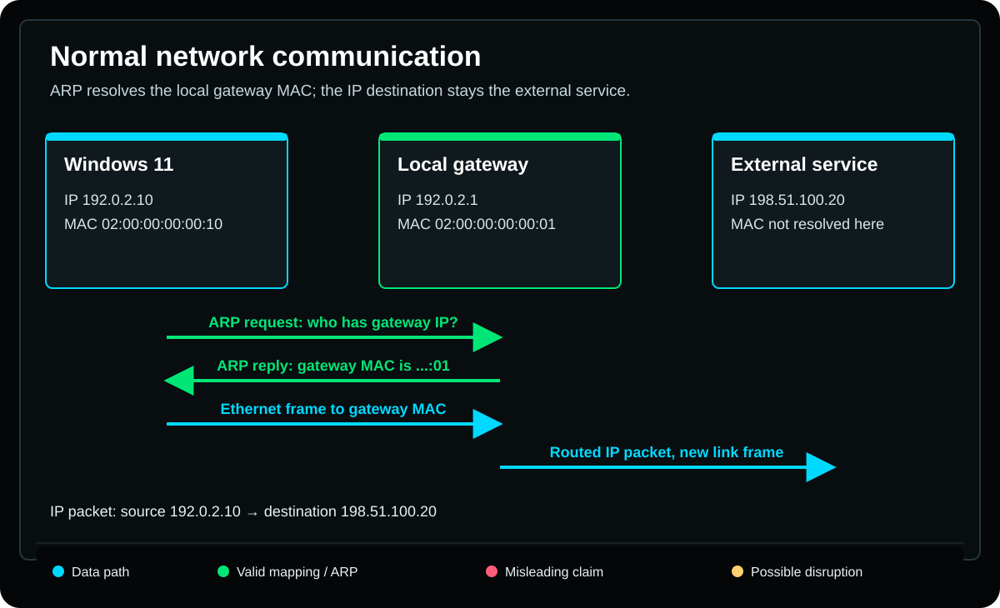

# 01 — Network foundations

[Start](../README.md) · [Glossary](glossary.md)

## Two addresses, two jobs

An **IPv4 address** identifies a logical interface location within an IP network. A **MAC address** identifies a network interface on a local link. Think of IP as where the packet is logically going, and MAC as which interface receives the current Ethernet frame. A host needs both because Ethernet carries an IP packet inside a frame. Routers strip and rebuild link-layer frames at each hop; the source and destination MACs generally change, while the IP addresses usually remain the same (apart from operations such as NAT).

For an off-subnet destination, the host sends the frame to its **default gateway**. ARP resolves that gateway's IPv4 address to a MAC on the local link. For a same-subnet destination, the host normally resolves the destination host directly. A VM has its own virtual NIC and MAC; its current MAC need not equal a physical adapter's factory address.



*Cyan denotes the local Ethernet data path. Green denotes a legitimate ARP mapping. The routed hop uses a different Ethernet frame.*

## Normal ARP resolution

```mermaid
sequenceDiagram
    participant H as Windows host
    participant L as Local Ethernet link
    participant G as Gateway
    H->>H: Need off-subnet destination; choose gateway IP
    H->>L: Broadcast ARP: Who has gateway IPv4?
    L->>G: Deliver broadcast on this link
    G-->>H: ARP reply: gateway IPv4 is at gateway MAC
    H->>H: Cache IPv4-to-MAC mapping
    H->>G: Unicast Ethernet frame to gateway MAC, carrying IP packet
```

*Legend: broadcast request reaches the local link; the reply provides the gateway MAC; the final arrow is data traffic.* An unsolicited or misleading ARP message can influence some hosts' neighbor state. That is a separate trust issue, and behavior varies by operating system and cache state.

## Read the local Linux interface

| Command | Reads | Does not reveal |
| --- | --- | --- |
| `ip -br addr` | Concise local interface and IP configuration | Every host on the network |
| `ip link show` | Local link state and MAC details | Gateway reachability |
| `ip route` | Local route decisions | Neighbor MACs |
| `ip neigh` | Current neighbor mappings | Complete network inventory |
| `cat /sys/class/net/<interface>/address` | Current MAC exposed for one local interface | That interface's IPv4 address or another host's MAC |

`/sys` is a virtual filesystem exposing kernel device information. `/sys/class/net/` contains entries for network interfaces; the `address` file exposes each interface's current link-layer address. `cat` reads that file. It does not send a packet or discover another computer. The source script's comments use `enp0s3` as an example; **no saved interface inspection confirms that name in a completed run**. For an illustrative VM whose interface is named `enp0s3`:

```bash
cat /sys/class/net/enp0s3/address
```

Illustrative output only: `02:00:00:00:00:15`. The current MAC may be virtual, randomized, or administratively changed; it is not necessarily the permanent hardware address.

## Read the route

```bash
ip route
```

Illustrative line only: `default via 10.0.2.1 dev enp0s3`. `default` handles destinations without a more specific route, `via` names the next-hop gateway IP, and `dev` names the outgoing interface. The `10.0.2.x` values in the original README and script comments are examples, **not independently verified lab addresses**.

## Read the neighbor cache

```bash
ip neigh
```

```powershell
arp -a
```

| State | Illustrative gateway mapping | Meaning |
| --- | --- | --- |
| Baseline | `10.0.2.1 → 02:00:00:00:00:01` | Host currently associates gateway IP with its expected MAC |
| Misleading claim | `10.0.2.1 → 02:00:00:00:00:15` | Host may direct gateway-bound frames to another interface |

**These MACs are fabricated teaching values.** Dynamic entries age, expire, and refresh. Static entries are manually configured and can be brittle if hardware or topology changes. An altered entry is a useful signal, especially against a trusted baseline, but it cannot by itself establish who sent the claim or whether any data was relayed. Compare a time-matched capture and connectivity checks. See [victim observations](04-victim-observations.md).
