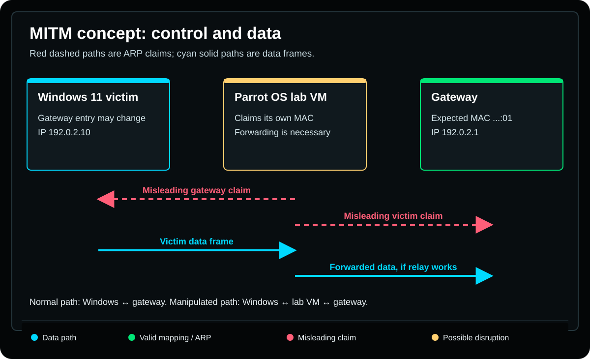
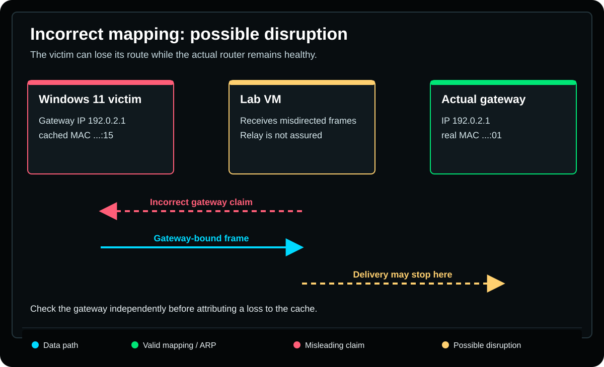

# 03 — What the existing modes implement

[Start](../README.md) · [Victim measurements](04-victim-observations.md)

The reviewed local source `scripts/arp_lab.py` defines three modes. The **victim** is the Windows host whose neighbor state is observed; the **gateway** is the next hop for off-subnet IPv4 traffic; the **lab host** is the Parrot/Linux VM running the script. All three must be situated on a link where the relevant ARP frames can reach their intended peers. The source comments use `10.0.2.x` and `enp0s3` as examples, not verified measurements.

*Red arrows represent misleading ARP claims. Cyan arrows represent data frames. The diagram is conceptual, not a captured run.*

ARP's weak trust model permits an IP-to-MAC claim without cryptographic proof. The script first attempts to resolve victim and gateway MACs. Its ordinary teardown sends corrective ARP frames and restores the prior IPv4-forwarding setting when that prior value is readable. An abrupt kill or failed delivery can prevent complete recovery; verify the peers afterward.

| Mode | Concept | Expected observation if the setup supports it | Security lesson |
| --- | --- | --- | --- |
| `mitm` | Claims each peer's IP at the lab host MAC, enables IPv4 forwarding, and counts sniffed packets | Both peers' mappings change; connectivity may continue; independent capture confirms path | Two-sided cache manipulation plus forwarding can redirect a local flow |
| `takeover` | Sends a gateway claim to the victim without enabling forwarding | Victim mapping changes; off-subnet connectivity may fail | A wrong next-hop MAC can interrupt delivery even while the router remains healthy |
| `flood` | Sends many forged claims for addresses in the gateway's `/24` prefix while forwarding is enabled | Capture may show repeated claims; relevant cache entries or connectivity may vary | Neighbor state and control traffic require careful measurement |

### MITM mode

The source implements bidirectional claims, forwarding, and a sniffer thread that counts packets by protocol and peer IP. Forwarding is essential to a transparent path, but enabling it does not guarantee that the virtual switch, host routing, firewall, or target behavior will permit relay. The counters count frames visible to the script's sniffer; they are not proof of end-to-end interception or data disclosure. Evidence would pair baseline and during-state neighbor entries from both endpoints with a time-matched packet capture and connectivity checks.

### Takeover mode

The victim can receive an incorrect gateway mapping and send frames toward an interface that does not relay them. The gateway itself can remain available to other hosts. Compare victim cache, route, and gateway reachability with another unaffected machine to separate a local mapping fault from a router outage. The source does not turn forwarding on for this mode; it also does not explicitly force an already-enabled system forwarding value off. Therefore “no forwarding” is the mode's intent, not an absolute runtime guarantee.

*Red is the wrong cached mapping. Amber indicates traffic that can fail to reach the gateway.*

### Flood mode

The source generates repeated forged ARP replies for IPv4 addresses derived from the gateway's first three octets. It starts a flood worker and reporter, **not the sniffer worker**; its packet counters therefore do not establish received traffic volume in this mode. It enables forwarding, but the selected workers do not run the normal bidirectional poison loop. “ARP table overflow” in the old README was an unsupported outcome claim: cache acceptance and capacity depend on the victim. Relevant measurements are time-matched ARP captures, neighbor entries, loss and latency, with a baseline and controlled duration. Keep the experiment isolated and bounded, never on a shared or production link.

*Repeated claims are control traffic, not proof that the victim accepted each mapping.*

## Evidence boundary

The repository supplies source and a prior README, but no saved packet captures, screenshots, console logs, or paired endpoint results. Thus it establishes **implementation intent only**. A changed gateway MAC alone does not identify the sender or prove a relay; a failed ping alone does not prove poisoning. Use the [blank results template](../results/README.md) for future, sanitized observations.
