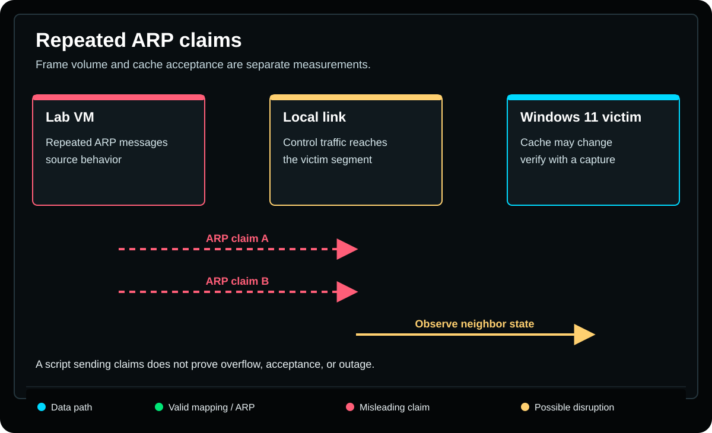

# 03 — Implemented laboratory modes

[Start](../README.md) · [Victim measurements](04-victim-observations.md)

The author successfully executed ARP poisoning in the controlled lab. The reviewed local `scripts/arp_lab.py` defines three modes. The **victim** is the Windows host whose neighbor state is observed; the **gateway** is the next hop for off-subnet IPv4 traffic; the **lab host** is the Parrot/Linux VM running the script. The source comments use `10.0.2.x` and `enp0s3` as examples, not published measurements. The operational Python source remains local; the read-only [Windows observer](../scripts/win11_probe.ps1) is in the public checkout.

*Red arrows represent misleading ARP claims. Cyan arrows represent data frames. The artwork explains the implemented path; its addresses are illustrative.*

ARP's weak trust model permits an IP-to-MAC claim without cryptographic proof. The script first attempts to resolve victim and gateway MACs. Its ordinary teardown sends corrective ARP frames and restores the prior IPv4-forwarding setting when that prior value is readable. An abrupt kill or failed delivery can prevent complete recovery; verify the peers afterward.

| Mode | Implemented behavior | Observation to examine | Security lesson |
| --- | --- | --- | --- |
| `mitm` | Claims each peer's IP at the lab host MAC, enables IPv4 forwarding, and counts sniffed packets | Victim and gateway mappings, connectivity, and captured path | Two-sided cache manipulation plus forwarding can redirect a local flow |
| `takeover` | Sends a gateway claim to the victim without enabling forwarding | Victim mapping and off-subnet reachability | A wrong next-hop MAC can interrupt delivery even while the router remains healthy |
| `flood` | Sends repeated forged claims for addresses in the gateway's `/24` prefix | ARP capture, cache changes, and connectivity | Neighbor state and control traffic require careful measurement |

### MITM mode

The source implements bidirectional claims, forwarding, and a sniffer thread that counts packets by protocol and peer IP. This is the mode most directly connected to the author's confirmed ARP poisoning result. Forwarding is essential to a transparent path; counters measure frames visible to that sniffer rather than decrypted content. Paired endpoint entries and a capture can document the path in more detail when available.

### Takeover mode

The victim can receive an incorrect gateway mapping and send frames toward an interface that does not relay them. The gateway itself can remain available to other hosts. Compare victim cache, route, and gateway reachability with another unaffected machine to separate a local mapping fault from a router outage. The source does not turn forwarding on for this mode; it also does not explicitly force an already-enabled system forwarding value off. Therefore “no forwarding” is the mode's intent, not an absolute runtime guarantee.

*Red is the wrong cached mapping. Amber indicates traffic that can fail to reach the gateway.*

### Flood mode

The source generates repeated forged ARP replies for IPv4 addresses derived from the gateway's first three octets. It starts a flood worker and reporter, **not the sniffer worker**; its packet counters therefore do not establish received traffic volume in this mode. It enables forwarding, but the selected workers do not run the normal bidirectional poison loop. “ARP table overflow” in the old README was an unsupported outcome claim: cache acceptance and capacity depend on the victim. Relevant measurements are time-matched ARP captures, neighbor entries, loss and latency, with a baseline and controlled duration. Keep the experiment isolated and bounded, never on a shared or production link.

*Repeated claims are control traffic, not proof that the victim accepted each mapping.*

## What the completed experiment establishes

**Author-reported result:** ARP poisoning succeeded in the controlled lab. **Source-reviewed implementation:** the three modes above and normal-teardown restoration logic. The public repository does not include raw captures or mode-specific measurements, so it makes no packet-count, transparent-interception, or outage claim. [Experiment record](../results/README.md) separates the confirmed account from measurements that could be published later.
