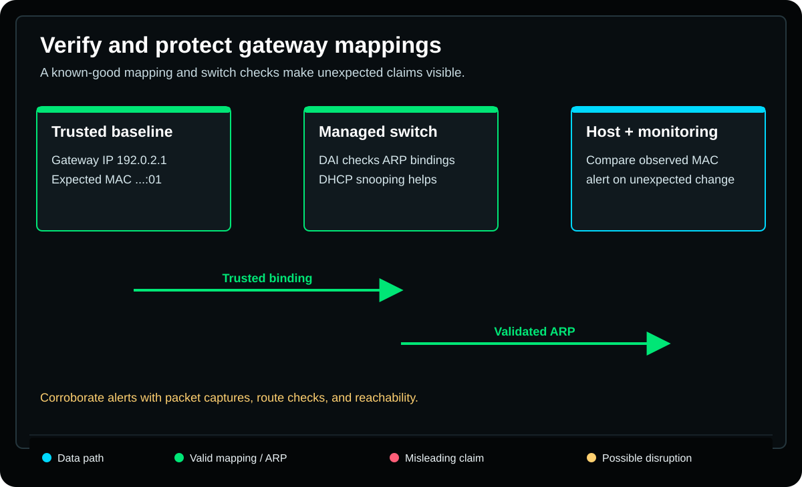

# 05 — Defense and mitigation

[Start](../README.md) · [Network foundations](01-network-foundations.md)

*Green shows a verified gateway mapping. Amber marks unexpected ARP claims for review. A switch with inspection support can reject invalid claims before they reach a host.*

## Detect a change

Record the gateway IP and MAC from a trusted network inventory. Compare that baseline to `ip neigh`, Windows `arp -a`, or a managed-switch table on the **correct interface**. A new MAC is a signal to investigate. In a packet capture, check for repeated replies claiming the gateway IP, unsolicited claims, conflicting MACs, and timing that matches cache changes. A capture is stronger when taken on the affected link and paired with route and connectivity observations; a cache entry alone cannot show who sent an ARP message.

## Reduce exposure

| Control | What it does | Limit |
| --- | --- | --- |
| Dynamic ARP Inspection (DAI) | Supported managed switches validate ARP claims against trusted bindings | Requires careful switch configuration; incorrect bindings can block legitimate traffic |
| DHCP snooping | Builds IP-to-MAC-to-port bindings from trusted DHCP exchanges that DAI can use | Static-IP hosts may need manually maintained bindings |
| Layer 2 segmentation | Keeps one broadcast domain from spanning unnecessary devices | Hosts sharing a segment still need protection |
| Static ARP entry | Pins a selected mapping on a host | Hard to maintain at scale and can break after legitimate gateway changes |
| Monitoring and alerting | Flags gateway MAC changes or conflicting ARP claims | Requires a trustworthy baseline and noise handling |
| HTTPS/TLS | Protects application data confidentiality and authenticity when correctly validated | Does **not** prevent ARP poisoning or guarantee availability |

DAI and DHCP snooping behavior depends on switch support and configuration. See [Cisco's DAI explanation](https://www.cisco.com/c/en/us/td/docs/switches/lan/catalyst3560/software/release/15-0_2_se/configuration/guide/scg3560/swdynarp.html).

## Recover after an invalid entry

Stop the isolated experiment, confirm the gateway's real MAC from a trusted source, and allow the operating system to relearn its neighbor entry or clear the affected dynamic entry with administrator-approved procedures. Check that both victim and gateway mappings return to their baseline and that connectivity recovers. The existing Python script attempts corrective ARP frames during normal teardown, but a hard stop or lost frames can leave stale state; always verify recovery rather than assuming it.
