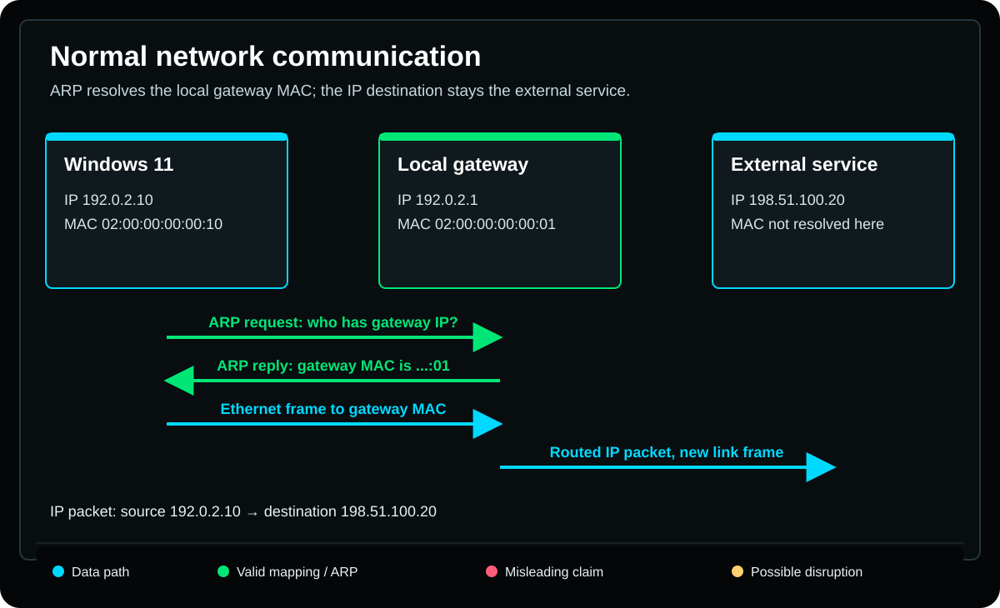

# 06 — Topology and evidence boundaries

[Start](../README.md) · [Host discovery](02-host-discovery.md)

## The intended classroom topology

The source describes a Parrot/Linux lab host, a Windows 11 victim, and a gateway. Its `10.0.2.x` addresses are defaults and examples in the script and old README. There is no saved `ip route`, `ipconfig`, VirtualBox configuration, or packet capture proving the actual deployed interface names, addresses, network mode, or outcomes. All artwork uses **illustrative addresses**.

| Component | Example label | What must be checked in a real isolated setup |
| --- | --- | --- |
| Windows victim | `10.0.2.6` | Active adapter, route, gateway, and neighbor cache |
| Parrot/Linux lab VM | `10.0.2.15` | Interface, route, current MAC, and shared-link membership |
| Gateway | `10.0.2.1` | Actual gateway interface and trusted MAC |

*ARP resolves the next-hop IPv4 address on the local link. It does not resolve an external server's MAC across a router.*

## Choosing an isolated VirtualBox link

An **Internal Network** with the same name on the relevant VMs keeps traffic among those VMs by default. It supplies no external gateway automatically: use an explicitly configured gateway VM if routed traffic is part of the lesson. A **Host-only** network lets the host participate with the VMs but ordinarily has no direct external LAN path; host services and host firewall behavior still matter. Ordinary per-VM **NAT** is not automatically a shared Layer 2 topology. **NAT Network** is a separate mode with guest-to-guest communication when configured on the same network. **Bridged** mode attaches to the physical LAN and can affect unrelated devices, so it is unsuitable for these demonstrations without a dedicated, authorized segment. See [Oracle's mode comparison](https://docs.oracle.com/en/virtualization/virtualbox/7.2/user/networkingdetails.html).

Before any experiment, confirm the intended machines' routes and that the relevant interfaces are on the same broadcast domain. Afterward, verify cache recovery. These are topology checks, not proof of a successful experiment.

## Claims ledger

| Claim | Status in this repository |
| --- | --- |
| Python script defines three modes and attempts normal teardown restoration | Verified by source inspection |
| Windows script observes cache, reachability, and counters without changing configuration | Verified by source inspection |
| A victim cache changed, traffic was relayed, or connectivity failed during a run | **Unverified: no saved results supplied** |
| A flood overflowed a table or caused a measured outage | **Unverified: no capture or measurement supplied** |
| The example `10.0.2.x` addresses were actually used in VirtualBox | **Unverified: examples only** |
